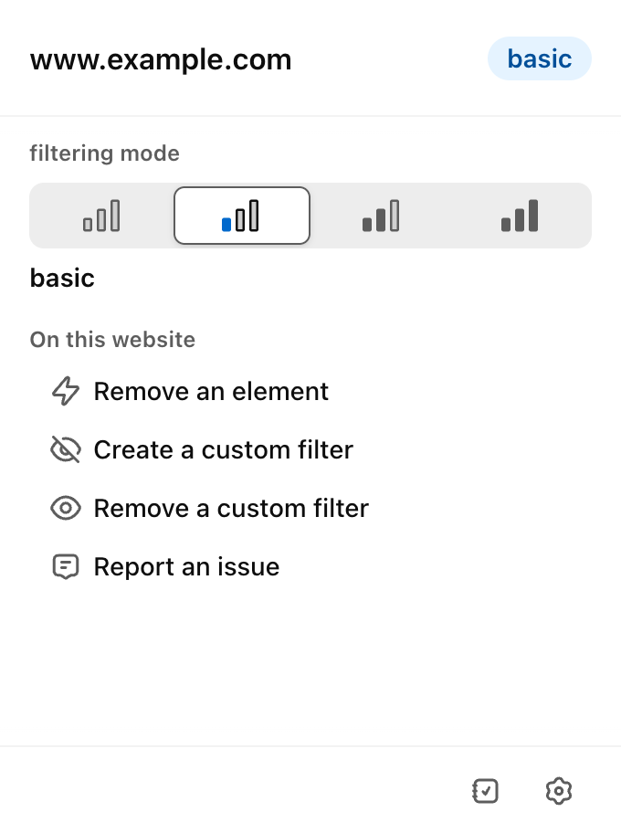
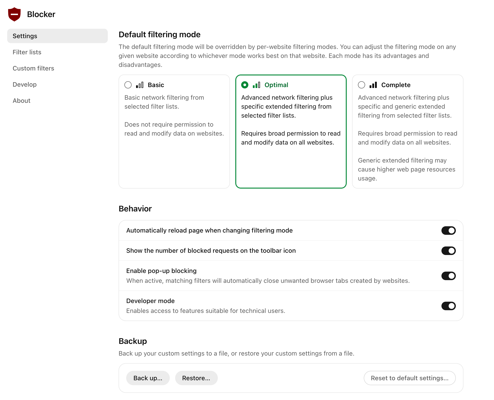
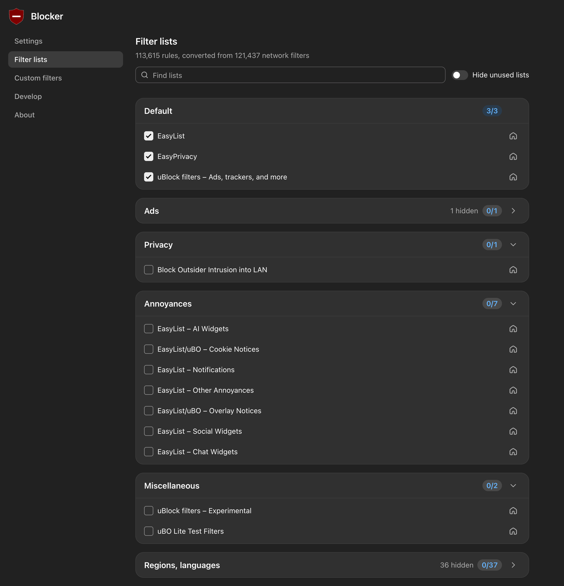
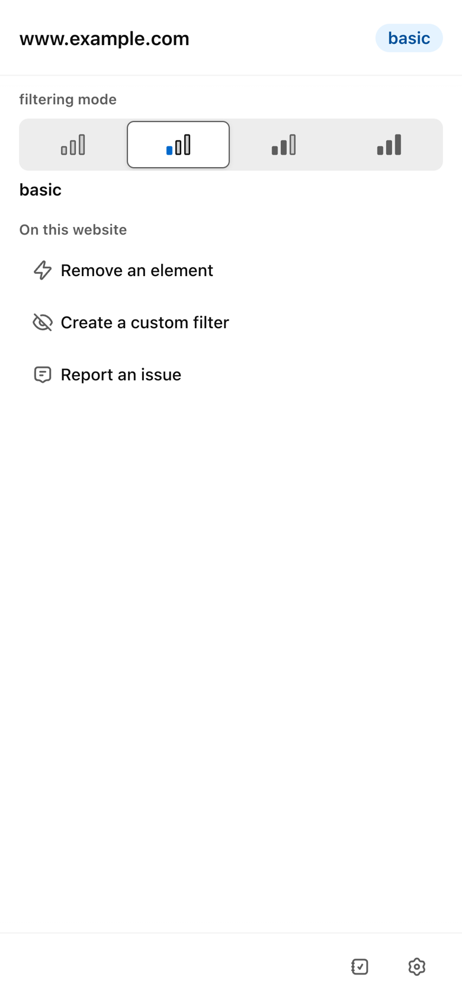
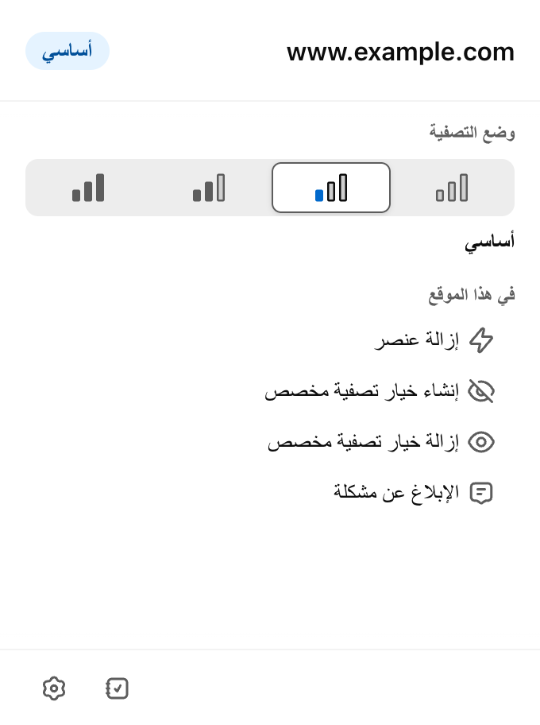
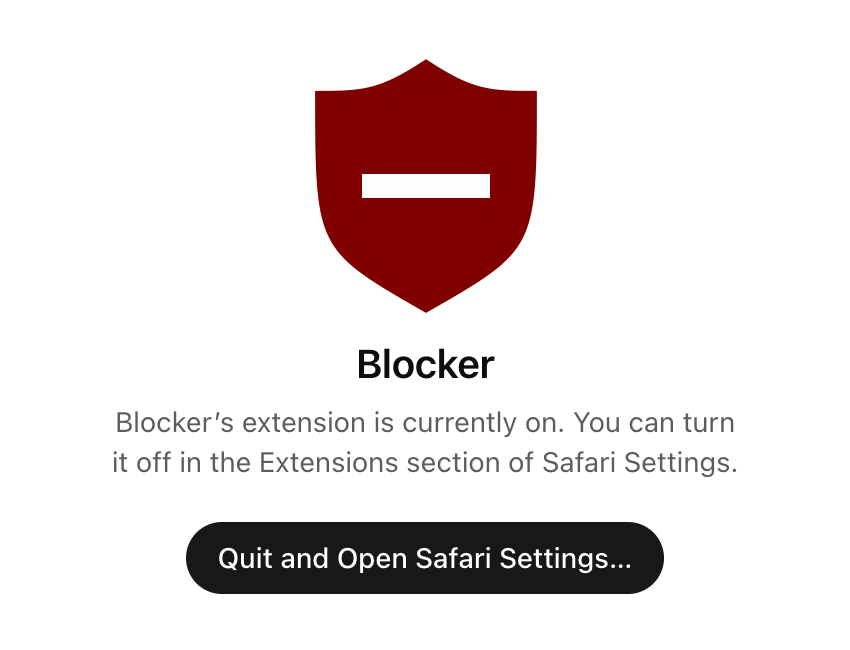

# Blocker

**Blocker** is [uBlock Origin Lite](https://github.com/uBlockOrigin/uBOL-home), the
Manifest V3 content blocker by Raymond Hill, with a new user interface. It builds for
Chrome, Edge, Firefox (desktop and Android) and Safari (macOS, iPhone and iPad).

The blocking engine is upstream's, unchanged: the same filter lists, rulesets,
background code and content scripts. Only the pages you look at are new: the toolbar
popup, the dashboard and the window of the Safari app. They are built with React,
Tailwind CSS 4 and OpenAI's [Apps SDK UI](https://openai.github.io/apps-sdk-ui/)
components. A safety gate in the build checks this, file by file, on every build.

> **Unofficial.** Blocker is an independent fork. It is not made, endorsed or supported
> by Raymond Hill, the uBlock Origin project or OpenAI. Do not report Blocker problems to
> uBlock Origin; see [Getting help](#getting-help).

| Popup | Dashboard: Settings | Dashboard: Filter lists (dark) |
|---|---|---|
|  |  |  |

| On a phone | Arabic (right to left) | Safari app on macOS |
|---|---|---|
|  |  |  |

More in [docs/screenshots](docs/screenshots/README.md).

## Features

- **Toolbar popup:** the site name with its filtering level, a four-step level control
  (no filtering, basic, optimal, complete) and the tools: element zapper, element picker,
  "remove a custom filter" and "report an issue". If the new popup ever fails to load,
  the original uBlock Origin Lite popup opens instead.
- **Dashboard, Settings:** default filtering mode, behaviour switches, strict blocking
  (Chrome, Edge and Firefox, as upstream), backup, restore and reset.
- **Dashboard, Filter lists:** searchable, grouped lists with rule counts and a "hide
  unused lists" switch. On Chrome, Edge and Firefox you can also import a list by URL and
  remove imported lists, as upstream allows there (Safari does not support it).
- **Dashboard, Custom filters and Develop:** upstream's own editors, embedded in the new
  dashboard and re-coloured to match.
- **Picker, zapper and report pages:** upstream's pages, re-coloured.
- **Safari app window** (macOS) and a short setup screen (iOS and iPadOS).
- Light and dark mode, right-to-left languages, keyboard navigation, touch layouts for
  phones, and all 71 languages of uBlock Origin Lite (a few new strings are English only).
- No telemetry and no remote code: every file ships inside the extension.

## Supported platforms

Status levels: **built** (the build and its checks pass), **launched** (the app or package
was opened or loaded, without using it), **used** (the extension was exercised in that browser).

| Browser / OS | Build target | Package | Status |
|---|---|---|---|
| Google Chrome, Chromium (Windows, macOS, Linux, ChromeOS), version 122+ | `chromium` | `dist/blocker-chromium-<version>.zip` | **Used:** Chrome 154 on macOS with the real extension engine (popup, dashboard, blocking). |
| Brave, Opera, other Chromium-based browsers | `chromium` | same zip | **Built** (same package as Chrome); not tried in these browsers. |
| Microsoft Edge 122+ | `edge` | `dist/blocker-edge-<version>.zip` | **Built;** the package was loaded in headless Chrome by the smoke test, not in Edge. |
| Firefox (desktop), version 128+ | `firefox` | `dist/blocker-firefox-<version>.xpi` | **Built** and linted, unsigned (temporary install, or sign it on AMO); not tried in Firefox. |
| Firefox for Android, version 128+ | `firefox` | same `.xpi` | **Built;** needs a signed or temporary install; not tried on a device. |
| Safari on macOS 13 or later, with Safari 18.6+ | `safari-macos` | `dist/Blocker-safari-macos-<version>.zip` (`Blocker.app`) | **Built** and signed (your Apple team, or ad hoc); the extension pages were rendered from the built app in headless Chrome. The app was not launched and the extension not tried in Safari by the project's checks. |
| Safari on iPhone and iPad (iOS / iPadOS 18.6+) | `safari-ios` | `dist/Blocker-safari-ios-<version>.zip` | **Launched:** the unsigned Simulator build opened in the iPhone 17 (iOS 26.5) and iPad mini (iOS 18.6) simulators; the extension was not tried in iOS Safari. Device builds need your Apple team and Xcode. |
| **Chrome for Android** | — | — | **Not available.** Chrome for Android cannot install extensions. Use Firefox for Android. |
| **Samsung Internet** | — | — | **Not available.** Samsung Internet cannot install WebExtensions like this one; its "ad blockers" are separate Android apps using Samsung's own interface. |
| **Standalone Windows or Linux app** | — | — | **Not planned.** Not needed: desktop browsers install the extension directly. Safari is the only browser that needs a host app. |
| **Android app** | — | — | **Not planned.** Chrome for Android has no extension support, so an app could not add Blocker to it. On Android, use Firefox for Android. |

Nothing is published to a browser store by this project. Build the packages yourself, or
download the ones attached to a GitHub release (see [Download](#download)), and load them;
or publish them under your own name (see [docs/building.md](docs/building.md)).

## Download

When the maintainers tag a release, its entry on this repository's **Releases** page
carries the packages built by GitHub Actions from that tag, with fresh filter lists, plus
`SHA256SUMS.txt`:

| File | For | Signed? |
|---|---|---|
| `blocker-chromium-<version>.zip` | Chrome, Chromium, Brave, Opera | no store signature: unzip and load the folder unpacked |
| `blocker-edge-<version>.zip` | Microsoft Edge | as above |
| `blocker-firefox-<version>.xpi` | Firefox desktop and Firefox for Android | unsigned: temporary install only, or sign it on AMO |
| `Blocker-safari-macos-<version>.zip` | Safari on macOS | ad hoc, not notarized: see [first launch on macOS](docs/building.md#first-launch-of-a-downloaded-app) |
| `Blocker-safari-ios-<version>.zip` | the iOS Simulator only | unsigned; a device build needs your own Apple team |

Install steps for each browser: [docs/building.md](docs/building.md). For daily use you
will want a signed build: sign the `.xpi` on AMO, and build the Safari app with your own
Apple team.

## Quick start

You need Git, Node.js 22.12 or later with npm, `make`, `jq`, `zip` and `unzip`. Safari
targets also need macOS with Xcode. Details per system: [docs/building.md](docs/building.md#prerequisites).
Replace `<you>` with the account or organisation that hosts your copy.

```sh
git clone --recursive https://github.com/<you>/blocker.git
cd blocker
npm --prefix ui ci
./scripts/build.sh chromium        # or: edge | firefox | safari-macos | safari-ios | all
```

The result is in `dist/`. The clone takes a few minutes: `upstream/` brings the full
history of uBlock Origin (about 2.5 minutes for `git clone --recursive` on a fast
connection). The first build of each target downloads the filter lists (under a minute
per platform on a good connection); later builds reuse the cache in
`upstream/dist/build/mv3-data/`, so their lists do not change. To get current lists, see
[Filter lists](docs/building.md#filter-lists).

If you cloned without `--recursive`, run `./scripts/bootstrap.sh` once: it fetches the
`upstream/` submodule with its two submodules and runs `npm ci` in `ui/`.

Then load the build into your browser:

| Browser | Do this |
|---|---|
| Chrome, Brave, Opera | `chrome://extensions` (`brave://extensions`, `opera://extensions`) → Developer mode → **Load unpacked** → `build/package/chromium` |
| Edge | `edge://extensions` → Developer mode → **Load unpacked** → `build/package/edge` |
| Firefox | `about:debugging#/runtime/this-firefox` → **Load Temporary Add-on…** → the `.xpi` in `dist/` |
| Firefox for Android | install a signed `.xpi`, or load it from your computer over USB with `web-ext run -t firefox-android`: see [platforms/firefox](platforms/firefox/README.md) |
| Safari (macOS) | Open `build/xcode/safari-macos/DerivedData/Build/Products/Release/Blocker.app` once, then Safari → Settings → Extensions → tick **Blocker** |
| Safari (iPhone, iPad) | needs your Apple team and Xcode for a device, or the iOS Simulator: see [Safari on iOS and iPadOS](docs/building.md#safari-on-ios-and-ipados) |

Full steps for each browser, signing and store notes: [docs/building.md](docs/building.md).

## How it works, in one picture

```text
upstream/ (uBlock Origin, pinned)  ──make──▶  original extension
                                               │  rename to "Blocker"
                                               ▼
                                  build/pristine/<platform>      (reference copy)
ui/ (React) ──vite──▶ ui/dist ──┐              │
                                └──── stage ───▶ build/stage/<platform>
                                                 │  safety gate: every file outside the
                                                 │  new pages must equal the reference
                                                 ▼
                          zip / xpi / Xcode project + xcodebuild  ──▶  dist/
```

More in [docs/architecture.md](docs/architecture.md).

## Documentation

| Document | For |
|---|---|
| [docs/building.md](docs/building.md) | prerequisites, every build target, installing, signing, troubleshooting |
| [docs/architecture.md](docs/architecture.md) | how the overlay, the safety gate and the message bridge work |
| [docs/updating-upstream.md](docs/updating-upstream.md) | moving to a newer uBlock Origin Lite |
| [docs/building.md#ci-and-releases](docs/building.md#ci-and-releases) | the GitHub Actions workflows and how to cut a release |
| [CONTRIBUTING.md](CONTRIBUTING.md) | development setup, the browser-free test harness, tests, code style |
| [docs/specs/](docs/specs/README.md) | behaviour specs of every page, with citations into the upstream source |
| [docs/mock-harness.md](docs/mock-harness.md) | the mock extension API used in development and tests |
| [platforms/chromium](platforms/chromium/README.md), [platforms/firefox](platforms/firefox/README.md), [platforms/safari](platforms/safari/README.md) | platform details |
| [CHANGELOG.md](CHANGELOG.md), [SECURITY.md](SECURITY.md), [CODE_OF_CONDUCT.md](CODE_OF_CONDUCT.md) | project policies |

## Repository layout

```text
upstream/         uBlock Origin source (git submodule, pinned; never edited)
ui/               the new user interface (React + TypeScript + Vite), its tests and the test harness
assets/icons/     editable icons: extension/, app/ (Safari app icon), app-window/
scripts/          build.sh (the one entry point), stage, safety gate, helpers
platforms/        packaging per browser: chromium/ (Chrome + Edge), firefox/, safari/
docs/             documentation, behaviour specs, screenshots
build/, dist/     build output (not committed)
```

## Getting help

- **Problems with Blocker's pages or build:** open an issue in this repository.
- **A website is broken or an ad is not blocked:** first check the same site with the
  official uBlock Origin Lite. If it fails there too, it is a filter-list matter for the
  [uBlock Origin filter maintainers](https://github.com/uBlockOrigin/uAssets/issues),
  not for this project.
- **Security issues:** see [SECURITY.md](SECURITY.md).

## Licence and credits

Blocker is free software under the **GNU General Public License v3.0 or later**
([LICENSE](LICENSE)), the same licence as uBlock Origin.

- **uBlock Origin and uBlock Origin Lite**: Copyright (C) Raymond Hill and the
  [uBlock Origin contributors](https://github.com/gorhill/uBlock/graphs/contributors).
  Blocker is a modified version of their work.
- **New user interface**: Copyright (C) Blocker contributors.
- **Third-party code**: Apps SDK UI (MIT, OpenAI), React, Radix UI, Tailwind CSS and
  others; upstream ships Inter, Font Awesome, CodeMirror and more. The full list with
  licences is in [NOTICE.md](NOTICE.md). Every built extension contains
  `ui/THIRD-PARTY-NOTICES.txt`.
- **Filter lists** belong to their maintainers and keep their own licences.

"uBlock Origin" is the name of the upstream project; it is used here only to describe
where Blocker comes from. Browser names are trademarks of their owners.
